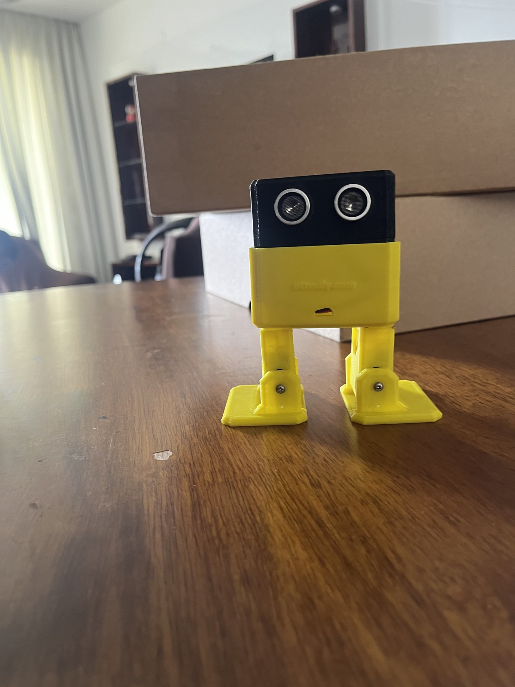
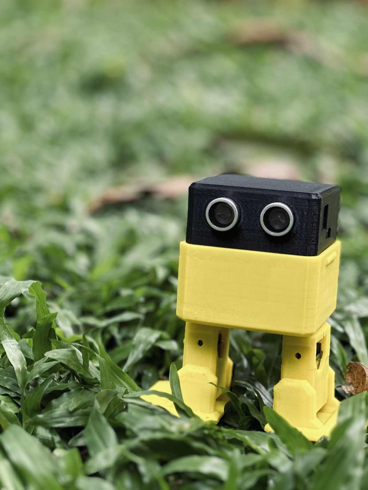
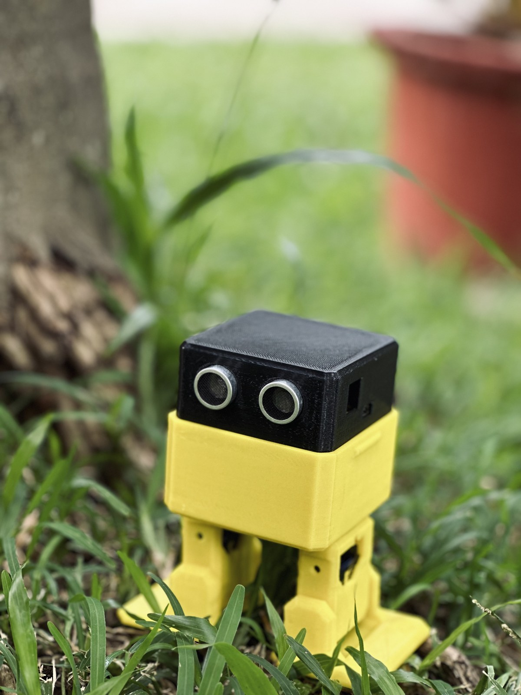
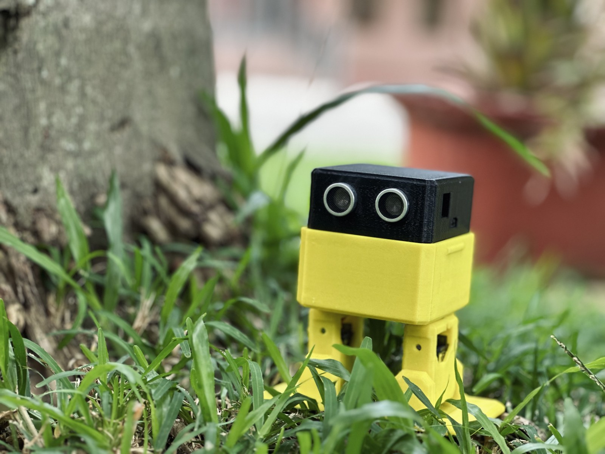
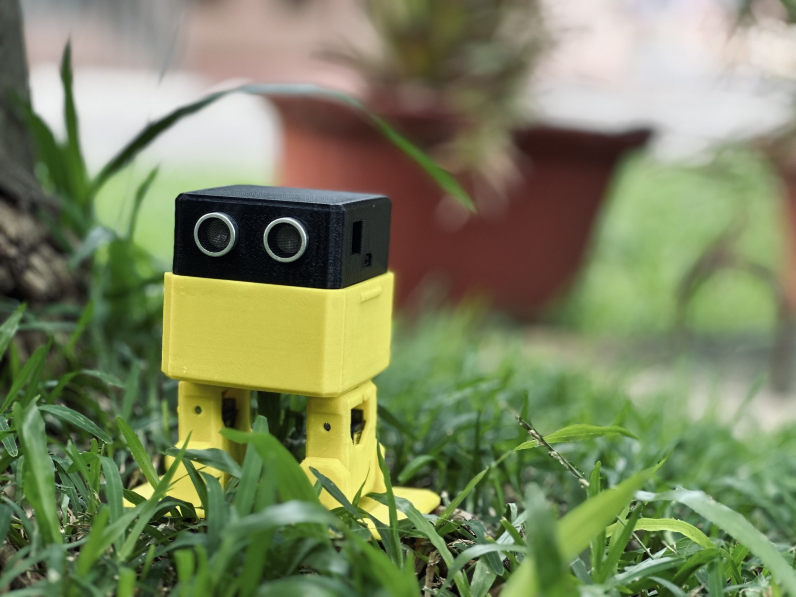

# Otto Biped Robot

A small two-legged robot built with an **Arduino Nano and four servo motors**. The physical robot successfully moved **forward and backward**, demonstrating basic biped locomotion through coordinated leg and foot motion.

## Hardware and operation

Two servo-driven legs and two servo-driven feet form the walking mechanism. The Arduino Nano controls the four servos to create the movement sequence.

| Item | Details |
| --- | --- |
| Controller | Arduino Nano |
| Actuation | Four servo motors |
| Demonstrated movements | Forward and backward |
| Original obstacle response | Not implemented |

## New obstacle-response firmware

The original project code is no longer available. A **new reference implementation** has been added in [firmware/OttoObstacleAvoidance](firmware/OttoObstacleAvoidance). It uses the official OttoDIY library and proposes an HC-SR04 ultrasonic sensor for obstacle response.

The new code provides one-step forward/backward commands and an automatic mode that checks distance between gait cycles, turns when blocked, and stops on invalid readings. This is newly written code; obstacle avoidance and turning have **not been validated on this robot**.

Read the [wiring, calibration and upload guide](firmware/README.md) before using it. The pin assignments are proposed, and the configuration starts locked until the wiring is checked.

## Robot gallery

