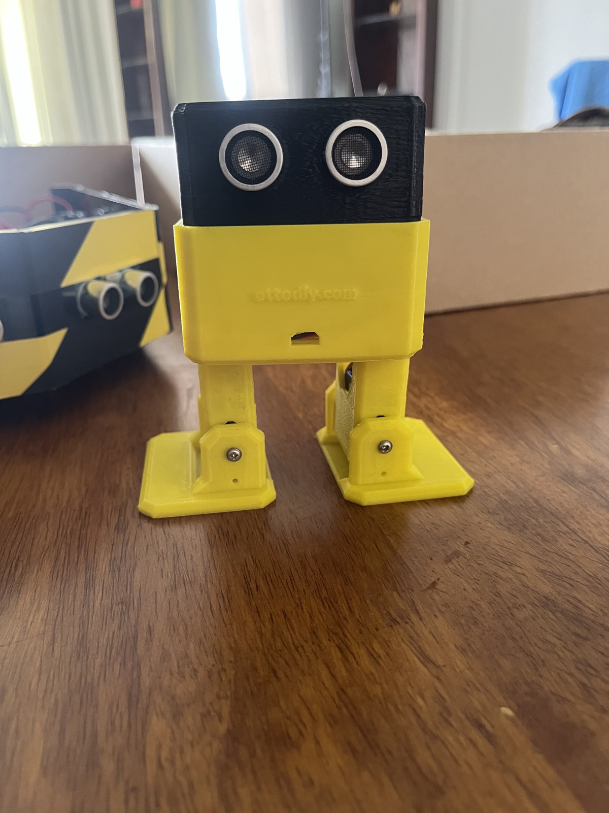

# Otto Biped Robot

An Otto-style biped robot documented through six photographs. The assembly has a compact body, two articulated legs and front-mounted ultrasonic transducers.

**Portfolio:** Thiruppathi P · [Thirusprojects](https://github.com/Thirusprojects)

## Project status

Physical robot photographs available. No firmware or movement video was included.

## Contribution

Personal assembly, design and programming contributions are awaiting confirmation.

## Design and documented features

- Two-legged robot assembly with broad feet.
- Yellow body/legs and black sensor housing.
- Front-mounted ultrasonic sensing hardware visible in photographs.

## Image gallery

- [Project image 1](media/images/img-0624.jpg)
- [Project image 2](media/images/img-0625.jpg)
- [Project image 3](media/images/img-5570.jpg)
- [Project image 4](media/images/img-5576.jpg)
- [Project image 5](media/images/img-5577.jpg)
- [Project image 6](media/images/img-5578.jpg)

## Evidence and limitations

Walking, dancing and obstacle-response behavior cannot be established from still photographs. Controller, servo models, power supply and firmware source are not yet confirmed. The Otto name identifies the supplied project; original authorship of the underlying robot platform is not claimed.

## Details to complete

Confirm controller, servo count, software/library used, your modifications and the movements that worked.

## File provenance

See [asset inventory](docs/ASSETS.md) for the mapping to supplied filenames. JPEG and MP4 exports are provided for browser access. Original presentation, PDF and CAD contents are retained where supplied.

This repository documents project materials supplied by the portfolio owner. Team work and third-party design contributions should be credited as their roles are confirmed.
